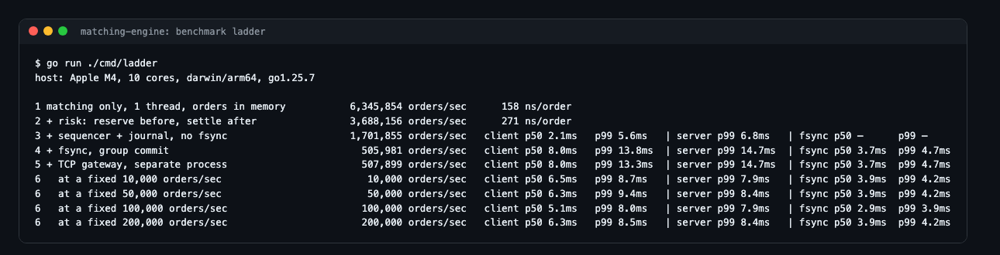
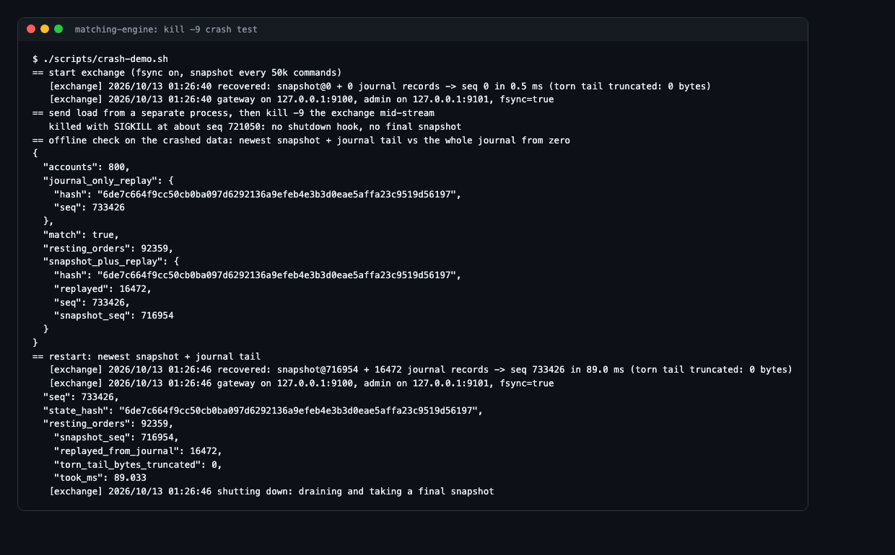
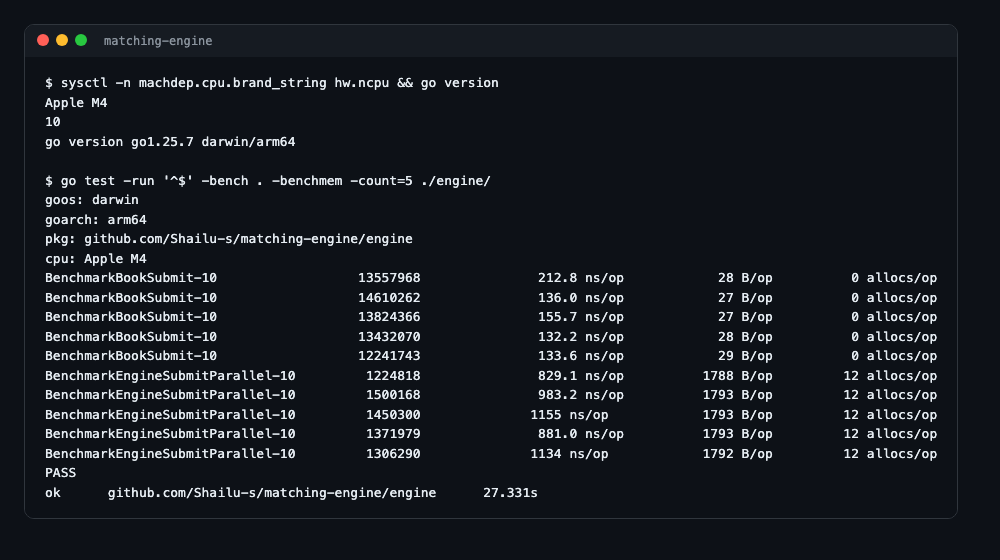

# Matching Engine

An exchange hot path in Go: TCP gateway, sequencer, write-ahead journal with
group-commit fsync, pre-trade risk, a price-time priority order book, and
crash recovery by snapshot + journal replay. Every layer is benchmarked on
its own, so each number says exactly what it includes.

| Measured on an Apple M4 laptop | |
|---|---|
| Matching core, one thread, orders in memory | 5.2-6.3M orders/sec |
| End to end: TCP, risk, matching, fsync before every ack | 501-513K orders/sec |
| Latency at a steady 10K-200K orders/sec | p50 5-7 ms, p99 8-14 ms |
| Recovery after kill -9 | snapshot + journal tail, state hash identical |

Three runs on a quiet laptop (Docker and other apps closed). Earlier runs
on a busy machine measured less and had p99 spikes of 50-800 ms; every run,
busy and quiet, is in [docs/ladder-runs.txt](docs/ladder-runs.txt). Go, standard library only.

**Live demo:** https://matching-engine-ydj6.onrender.com (free tier, the
first load after idle takes ~50 s). Opening the page runs a live benchmark on
the server.

## Durable exchange pipeline

The matching numbers below measure one loop with orders already in memory.
A real venue also has to take the order off the network, check risk, and
make it durable before saying "accepted". This repo builds that hot path
and measures it one layer at a time.

```
 loadgen (separate process)
    |  binary TCP protocol, pipelined, 16 connections
    v
 GATEWAY        per-connection reader/writer, backpressure at 4,096 in flight
    v
 SEQUENCER      single writer: stamps seq, batches whatever is waiting
    v
 JOURNAL        one write + one fsync per batch (group commit), CRC per record
    v           ...only now is the order durable
 CORE           one goroutine, no locks, no clock, no randomness
   risk #1      reserve cash/coins for the order
   matching     price-time priority (engine.Book)
   risk #2      settle both sides of every fill, refund unused holds
    v
 REPLY          ack carries seq (= order ID), filled, resting
```

- **Ack means durable.** A command is answered only after its batch is
  fsynced *and* applied. The sequencer and core are separate goroutines, so
  batch N+1 is being flushed while batch N is applied.
- **Deterministic core.** State is a pure function of the journal, so
  recovery is: load the newest snapshot, replay the journal after it,
  truncate a torn last record. `exchange -verify` rebuilds the state both
  that way and from the whole journal and compares SHA-256 state hashes.
- **Snapshots** are written atomically (temp file, fsync, rename, fsync dir)
  between batches, every N commands and on shutdown.
- **Deliberately not in the hot path:** Kafka, Postgres, market-data
  fan-out. They are consumers of the output stream; they add lag for
  downstream readers, not latency to an order.

### Benchmark ladder

`go run ./cmd/ladder -md docs/ladder.md` measures each layer with the same
order flow (limits around mid, 10% IOC, 10% cancels, 3 markets, 800 accounts):

| # | Adds | What it proves |
|---|---|---|
| 1 | matching only, one thread | the algorithm's cost |
| 2 | + risk reserve/settle | what pre/post-trade checks cost |
| 3 | + sequencer + journal write, no fsync | batching and file I/O |
| 4 | + fsync per batch (group commit) | the price of durability |
| 5 | + TCP gateway, separate process | end-to-end max throughput |
| 6 | same as 5 at fixed rates | latency when not saturated |

Rungs 3-5 are closed loop (every connection keeps 256 orders in flight), so
their latency is mostly queueing: 4,096 in flight / throughput. Rung 6 sends
on a clock and measures from the scheduled send time, so a stalled server
can't hide by slowing the client (coordinated omission). The table also
shows latency measured inside the server and the fsync time itself: on
macOS `fsync` is a full flush (`F_FULLFSYNC`), typically ~3-4 ms. The p50
sits near one and a half flushes, because an order waits for the flush in
progress and then its own.



Run 1 of three on a quiet laptop; all runs are in
[docs/ladder-runs.txt](docs/ladder-runs.txt). Across the three: end to end
501-513K orders/sec, p50 5-7 ms and p99 8-14 ms at every fixed rate. On a
busy machine (Docker and other apps running) the same p99 reached
50-800 ms: every order queued behind a slow flush waits for it. That is why
production venues replicate the journal to a second machine's memory instead
of putting a local fsync on the critical path.

### Crash test

`./scripts/crash-demo.sh` sends live load, `kill -9`s the exchange mid
stream, verifies the crashed data offline, and restarts it.


`go test ./exchange/ -run Kill9` does the same four times against the real
binary, sometimes appending a torn record, and asserts that no acknowledged
order is lost and that snapshot + replay equals full replay.

Note: `kill -9` proves process-crash recovery. The OS page cache survives a
process crash, so fsync is what covers power loss, which a test on a laptop
cannot simulate.

## Matching micro-benchmarks (Apple M4, 10 cores, Go 1.25.7)



| Path | Median of 5 runs | Range | Throughput |
|---|---|---|---|
| Raw book `Submit`, one thread, 0 allocs/op | 136 ns/order | 132-213 ns | **~7.4M orders/sec** |
| Full engine path: concurrent clients -> channel -> book goroutine -> reply | 983 ns/order | 829-1155 ns | **~1.0M orders/sec** |

Order flow: random limits clustered +/-50 ticks around mid (most cross and
trade) plus 5% market orders. Reproduce with:

```
go test -run '^$' -bench . -benchmem -count=5 ./engine/
```

**Live benchmark on the demo:** on page load the server pushes 500,000 random
orders through a fresh book in 10 batches of 50,000, times each batch on its
own and streams the results to the page. The headline is the median batch.
The free host is a shared fraction of one core, so its number is lower than
the laptop's.

**Scaling:** one market is single-threaded by design, because matching order
N+1 depends on order N. More cores do not make one book faster; they let more
markets run side by side, so total throughput grows with cores.

## Design

- **Integer ticks and lots.** No floating point anywhere in matching.
- **Price levels:** sorted slice per side (bids descending, asks ascending),
  best level always at index 0, plus a price -> level map. Levels are few
  compared with orders, so a contiguous slice beats a tree on cache behaviour.
- **Queue per level:** intrusive doubly linked list, FIFO for time priority,
  O(1) removal on cancel via an order-ID map.
- **Concurrency:** one goroutine owns each book and drains a command channel.
  No locks on the hot path; symbols match in parallel; matching is
  deterministic per symbol.
- **Trades execute at the maker's price.** Market order remainders are dropped
  (IOC semantics).
- **Fan-out never blocks matching:** subscribers get a buffered channel; a slow
  client misses events and resyncs from the depth snapshot in the next one.
  The SSE handler coalesces bursts to ~10 frames/sec per client.

## Demo accounts

Pick a username or continue as guest and you get $10,000 of demo USD. Lot
sizes are 0.001 BTC, 0.01 ETH and 0.1 SOL so small accounts can trade.

- **Before the book (risk #1):** `Reserve` holds the cash or coins an order
  could use and registers it, so a fill can never arrive for an unknown order.
- **After matching (risk #2):** the engine calls a `TradeHook` on the symbol's
  goroutine for every fill, maker and taker, before replying. Unlike the
  browser broadcast it never drops events, so it is where balances settle.
- Buys are held at the limit price and refunded the difference when they fill
  at the maker's better price. Market orders become IOC limits 5% through the
  touch, so the hold is bounded.
- Cash is integer milli-cents, so price x lots is exact in every market.
- Accounts live in memory and reset on restart. The benchmark uses a bare
  book, so the account layer is not in the measured path.

## Tests

`go test -race ./...` covers the pipeline (deterministic core, snapshot +
replay equals full replay, value conservation, risk rejects and refunds,
journal round trip and torn-tail truncation, wire protocol, TCP round trip,
graceful restart, and the kill -9 test above), plus price priority, time priority, maker-price
execution, market and IOC orders, cancel, rejects, a 50,000-order randomised
run that checks lot conservation and that the book is never left crossed,
that the trade hook sees every fill before the reply, and account tests:
maker-price refunds, no overspending or overselling, IOC and cancel releasing
holds, and 5,000 random orders across 20 accounts with total cash and coins
unchanged.

## API

| Method | Path | |
|---|---|---|
| POST | `/api/session` | `{"name"}` -> `{"token","account"}`; send the token as `X-Session` |
| GET | `/api/account` | balances, positions, open orders, fills, P/L |
| POST | `/api/orders` | `{"symbol","side":"buy|sell","type":"limit|market","price":<cents per coin>,"qty":<lots>}` |
| DELETE | `/api/orders/{id}` | cancel one of your orders |
| GET | `/api/depth/{symbol}` | top 15 levels |
| GET | `/api/stream/{symbol}` | SSE: depth + trades |
| GET | `/api/markets` | symbols and lot sizes |
| GET | `/api/benchmark` | live run, streamed as NDJSON (one line per batch, then a summary) |

## Run

```
go run ./cmd/exchange -dir data          # durable pipeline: TCP :9100, admin :9101
go run ./cmd/loadgen                     # closed loop against it
go run ./cmd/loadgen -rate 50000         # fixed rate
curl localhost:9101/state                # seq, state hash, batch sizes, latencies
go run ./cmd/exchange -dir data -verify  # snapshot+replay vs full replay
go run ./cmd/ladder                      # the benchmark ladder

go run ./cmd/server      # web demo: http://localhost:8080
docker build -t me . && docker run -p 8080:8080 me
```
